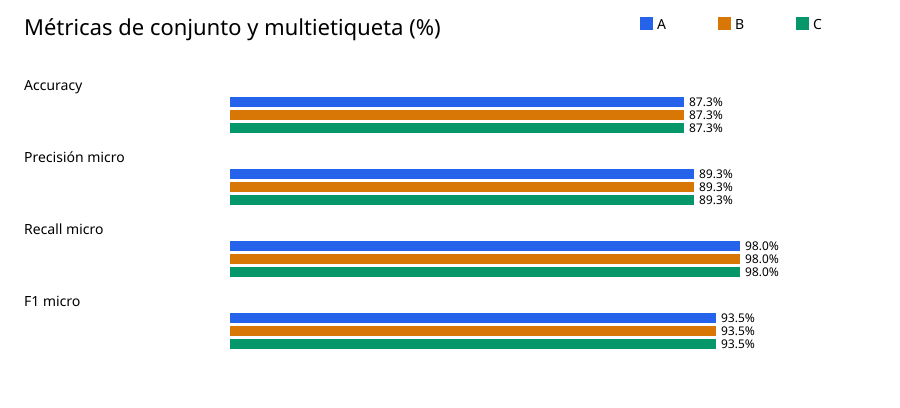
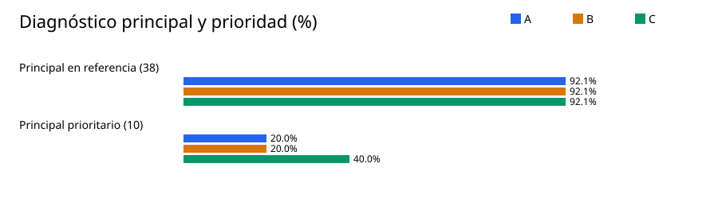
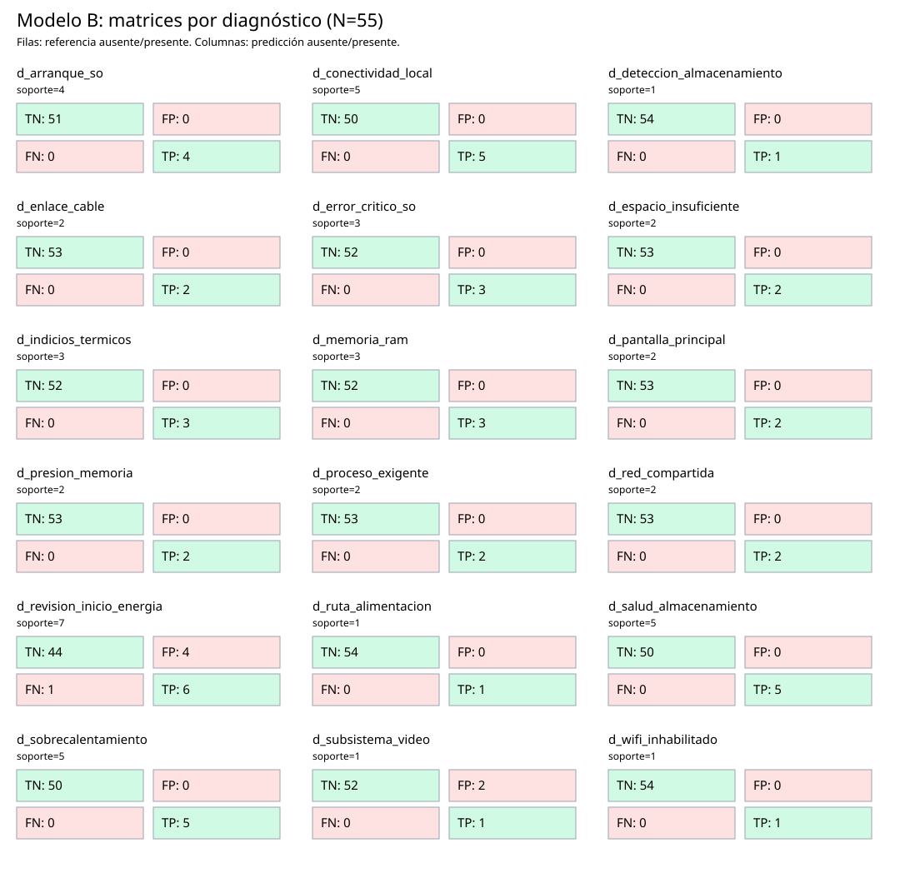
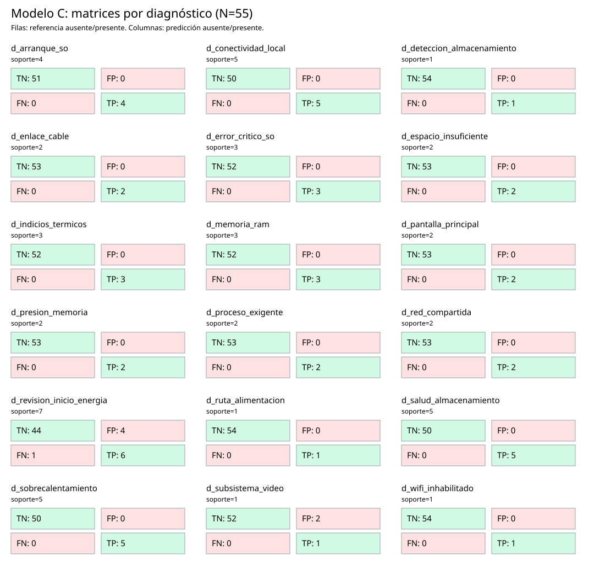

# Resultados experimentales — Avance 2, etapa 5

## Metodología y custodia

Se evaluaron 55 de los 60 casos de desarrollo: 54 de cuestionario extremo a extremo y D050 fuera del catálogo. Se excluyeron D012, D022, D032, D043 y D060 por limitación del cuestionario. Las viñetas son académicas; las etiquetas son hipótesis defendibles, no fallas físicas confirmadas.

Cada trayecto se reprodujo con el gestor de preguntas. Los tres motores recibieron las mismas observaciones obtenibles, con `verdadero`, `falso` y `desconocido` distintos. La captura bruta se guardó antes de comparar etiquetas; relato, justificación y prioridad no fueron entradas de los motores. La reserva final no se abrió ni se ejecutó.

Versión de desarrollo: SHA-256 `9f06ba6aad8b61d9d8ecc923c27e364d580e1bf55731d4674aed903019447da9`. Python: `3.14.2`. Git HEAD: `0907b6220eac500aee5fb1eb5542df5862ddb385`. Predicciones: SHA-256 `239eda83afff45bca1be9c11847ba6fcadd248294db15b47b52c7b88b63e7ca2`. Las huellas completas, el estado previo de Git y los comandos están en `proveniencia.json`.

## Tabla comparativa

| Métrica | A | B | C |
| --- | ---: | ---: | ---: |
| Accuracy exacto | 48/55 (87.3 %) | 48/55 (87.3 %) | 48/55 (87.3 %) |
| Accuracy con referencia positiva | 32/38 (84.2 %) | 32/38 (84.2 %) | 32/38 (84.2 %) |
| Accuracy con referencia vacía | 16/17 (94.1 %) | 16/17 (94.1 %) | 16/17 (94.1 %) |
| Precisión micro | 50/56 (89.3 %) | 50/56 (89.3 %) | 50/56 (89.3 %) |
| Recall micro | 50/51 (98.0 %) | 50/51 (98.0 %) | 50/51 (98.0 %) |
| F1 micro | 100/107 (93.5 %) | 100/107 (93.5 %) | 100/107 (93.5 %) |
| Principal en referencia | 35/38 (92.1 %) | 35/38 (92.1 %) | 35/38 (92.1 %) |
| Abstenciones correctas | 16/17 (94.1 %) | 16/17 (94.1 %) | 16/17 (94.1 %) |
| Abstenciones incorrectas | 1/38 (2.6 %) | 1/38 (2.6 %) | 1/38 (2.6 %) |
| Salidas espurias con referencia vacía | 1/17 (5.9 %) | 1/17 (5.9 %) | 1/17 (5.9 %) |
| Principal prioritario, mismos 10 casos | 2/10 (20.0 %) | 2/10 (20.0 %) | 4/10 (40.0 %) |
| Rango recíproco medio, mismos 10 casos | 5.667/10 = 0.567 | 5.667/10 = 0.567 | 7.000/10 = 0.700 |
| TP | 50 | 50 | 50 |
| FP / hipótesis extra | 6 | 6 | 6 |
| FN / hipótesis omitidas | 1 | 1 | 1 |

Los 55 casos incluyen 38 referencias positivas y 17 vacías. La prioridad se evalúa sobre los mismos 10 casos para A, B y C; su rango recíproco vale cero cuando la prioridad está ausente. Las métricas micro usan los TP, FP y FN agregados, sin crear verdaderos positivos por pares vacíos.

### Comparación de prioridades justificadas

| Caso | Prioridad | A: principal / rango | B: principal / rango | C: principal / rango |
| --- | --- | --- | --- | --- |
| D013 | `d_salud_almacenamiento` | `d_proceso_exigente` / 2 | `d_proceso_exigente` / 2 | `d_proceso_exigente` / 2 |
| D021 | `d_memoria_ram` | `d_subsistema_video` / 2 | `d_subsistema_video` / 2 | `d_subsistema_video` / 2 |
| D025 | `d_memoria_ram` | `d_subsistema_video` / 3 | `d_subsistema_video` / 3 | `d_subsistema_video` / 2 |
| D030 | `d_salud_almacenamiento` | `d_arranque_so` / 2 | `d_arranque_so` / 2 | `d_arranque_so` / 2 |
| D033 | `d_salud_almacenamiento` | `d_arranque_so` / 2 | `d_arranque_so` / 2 | `d_arranque_so` / 2 |
| D037 | `d_sobrecalentamiento` | `d_indicios_termicos` / 2 | `d_indicios_termicos` / 2 | `d_sobrecalentamiento` / 1 |
| D044 | `d_sobrecalentamiento` | `d_indicios_termicos` / 2 | `d_indicios_termicos` / 2 | `d_sobrecalentamiento` / 1 |
| D045 | `d_wifi_inhabilitado` | `d_wifi_inhabilitado` / 1 | `d_wifi_inhabilitado` / 1 | `d_wifi_inhabilitado` / 1 |
| D046 | `d_enlace_cable` | `d_enlace_cable` / 1 | `d_enlace_cable` / 1 | `d_enlace_cable` / 1 |
| D059 | `d_salud_almacenamiento` | `d_arranque_so` / 3 | `d_arranque_so` / 3 | `d_arranque_so` / 2 |

## Matrices de confusión por diagnóstico

Cada matriz usa 55 casos. Filas: referencia ausente/presente; columnas: predicción ausente/presente. La tabla presenta TN, FP, FN y TP en ese orden.

Soporte bajo (≤2 casos): `d_deteccion_almacenamiento` (1), `d_enlace_cable` (2), `d_espacio_insuficiente` (2), `d_pantalla_principal` (2), `d_presion_memoria` (2), `d_proceso_exigente` (2), `d_red_compartida` (2), `d_ruta_alimentacion` (1), `d_subsistema_video` (1), `d_wifi_inhabilitado` (1). Interpretar sus resultados individuales con cautela.

### Modelo A

| Diagnóstico | Soporte | TN | FP | FN | TP |
| --- | ---: | ---: | ---: | ---: | ---: |
| `d_arranque_so` | 4 | 51 | 0 | 0 | 4 |
| `d_conectividad_local` | 5 | 50 | 0 | 0 | 5 |
| `d_deteccion_almacenamiento` | 1 | 54 | 0 | 0 | 1 |
| `d_enlace_cable` | 2 | 53 | 0 | 0 | 2 |
| `d_error_critico_so` | 3 | 52 | 0 | 0 | 3 |
| `d_espacio_insuficiente` | 2 | 53 | 0 | 0 | 2 |
| `d_indicios_termicos` | 3 | 52 | 0 | 0 | 3 |
| `d_memoria_ram` | 3 | 52 | 0 | 0 | 3 |
| `d_pantalla_principal` | 2 | 53 | 0 | 0 | 2 |
| `d_presion_memoria` | 2 | 53 | 0 | 0 | 2 |
| `d_proceso_exigente` | 2 | 53 | 0 | 0 | 2 |
| `d_red_compartida` | 2 | 53 | 0 | 0 | 2 |
| `d_revision_inicio_energia` | 7 | 44 | 4 | 1 | 6 |
| `d_ruta_alimentacion` | 1 | 54 | 0 | 0 | 1 |
| `d_salud_almacenamiento` | 5 | 50 | 0 | 0 | 5 |
| `d_sobrecalentamiento` | 5 | 50 | 0 | 0 | 5 |
| `d_subsistema_video` | 1 | 52 | 2 | 0 | 1 |
| `d_wifi_inhabilitado` | 1 | 54 | 0 | 0 | 1 |

### Modelo B

| Diagnóstico | Soporte | TN | FP | FN | TP |
| --- | ---: | ---: | ---: | ---: | ---: |
| `d_arranque_so` | 4 | 51 | 0 | 0 | 4 |
| `d_conectividad_local` | 5 | 50 | 0 | 0 | 5 |
| `d_deteccion_almacenamiento` | 1 | 54 | 0 | 0 | 1 |
| `d_enlace_cable` | 2 | 53 | 0 | 0 | 2 |
| `d_error_critico_so` | 3 | 52 | 0 | 0 | 3 |
| `d_espacio_insuficiente` | 2 | 53 | 0 | 0 | 2 |
| `d_indicios_termicos` | 3 | 52 | 0 | 0 | 3 |
| `d_memoria_ram` | 3 | 52 | 0 | 0 | 3 |
| `d_pantalla_principal` | 2 | 53 | 0 | 0 | 2 |
| `d_presion_memoria` | 2 | 53 | 0 | 0 | 2 |
| `d_proceso_exigente` | 2 | 53 | 0 | 0 | 2 |
| `d_red_compartida` | 2 | 53 | 0 | 0 | 2 |
| `d_revision_inicio_energia` | 7 | 44 | 4 | 1 | 6 |
| `d_ruta_alimentacion` | 1 | 54 | 0 | 0 | 1 |
| `d_salud_almacenamiento` | 5 | 50 | 0 | 0 | 5 |
| `d_sobrecalentamiento` | 5 | 50 | 0 | 0 | 5 |
| `d_subsistema_video` | 1 | 52 | 2 | 0 | 1 |
| `d_wifi_inhabilitado` | 1 | 54 | 0 | 0 | 1 |

### Modelo C

| Diagnóstico | Soporte | TN | FP | FN | TP |
| --- | ---: | ---: | ---: | ---: | ---: |
| `d_arranque_so` | 4 | 51 | 0 | 0 | 4 |
| `d_conectividad_local` | 5 | 50 | 0 | 0 | 5 |
| `d_deteccion_almacenamiento` | 1 | 54 | 0 | 0 | 1 |
| `d_enlace_cable` | 2 | 53 | 0 | 0 | 2 |
| `d_error_critico_so` | 3 | 52 | 0 | 0 | 3 |
| `d_espacio_insuficiente` | 2 | 53 | 0 | 0 | 2 |
| `d_indicios_termicos` | 3 | 52 | 0 | 0 | 3 |
| `d_memoria_ram` | 3 | 52 | 0 | 0 | 3 |
| `d_pantalla_principal` | 2 | 53 | 0 | 0 | 2 |
| `d_presion_memoria` | 2 | 53 | 0 | 0 | 2 |
| `d_proceso_exigente` | 2 | 53 | 0 | 0 | 2 |
| `d_red_compartida` | 2 | 53 | 0 | 0 | 2 |
| `d_revision_inicio_energia` | 7 | 44 | 4 | 1 | 6 |
| `d_ruta_alimentacion` | 1 | 54 | 0 | 0 | 1 |
| `d_salud_almacenamiento` | 5 | 50 | 0 | 0 | 5 |
| `d_sobrecalentamiento` | 5 | 50 | 0 | 0 | 5 |
| `d_subsistema_video` | 1 | 52 | 2 | 0 | 1 |
| `d_wifi_inhabilitado` | 1 | 54 | 0 | 0 | 1 |

## Errores por ruta y tipo de escenario

Los conteos de extras, omisiones y abstenciones pueden solaparse dentro de un caso.

### Ruta

| Modelo | Grupo | Casos | Exactos | Con extras | Con omisiones | Abstenciones indebidas | Salidas espurias |
| --- | --- | ---: | ---: | ---: | ---: | ---: | ---: |
| A | alimentacion | 6 | 5 | 1 | 0 | 0 | 1 |
| A | conectividad | 10 | 10 | 0 | 0 | 0 | 0 |
| A | general | 5 | 4 | 1 | 0 | 0 | 0 |
| A | lentitud | 9 | 9 | 0 | 0 | 0 | 0 |
| A | sistema | 9 | 9 | 0 | 0 | 0 | 0 |
| A | temperatura | 7 | 7 | 0 | 0 | 0 | 0 |
| A | video | 9 | 4 | 4 | 1 | 1 | 0 |
| B | alimentacion | 6 | 5 | 1 | 0 | 0 | 1 |
| B | conectividad | 10 | 10 | 0 | 0 | 0 | 0 |
| B | general | 5 | 4 | 1 | 0 | 0 | 0 |
| B | lentitud | 9 | 9 | 0 | 0 | 0 | 0 |
| B | sistema | 9 | 9 | 0 | 0 | 0 | 0 |
| B | temperatura | 7 | 7 | 0 | 0 | 0 | 0 |
| B | video | 9 | 4 | 4 | 1 | 1 | 0 |
| C | alimentacion | 6 | 5 | 1 | 0 | 0 | 1 |
| C | conectividad | 10 | 10 | 0 | 0 | 0 | 0 |
| C | general | 5 | 4 | 1 | 0 | 0 | 0 |
| C | lentitud | 9 | 9 | 0 | 0 | 0 | 0 |
| C | sistema | 9 | 9 | 0 | 0 | 0 | 0 |
| C | temperatura | 7 | 7 | 0 | 0 | 0 | 0 |
| C | video | 9 | 4 | 4 | 1 | 1 | 0 |

### Tipo de escenario

| Modelo | Grupo | Casos | Exactos | Con extras | Con omisiones | Abstenciones indebidas | Salidas espurias |
| --- | --- | ---: | ---: | ---: | ---: | ---: | ---: |
| A | ambigua | 6 | 6 | 0 | 0 | 0 | 0 |
| A | comprobacion_adicional | 6 | 5 | 1 | 0 | 0 | 1 |
| A | evidencia_suficiente | 20 | 18 | 2 | 0 | 0 | 0 |
| A | fuera_cobertura | 1 | 1 | 0 | 0 | 0 | 0 |
| A | insuficiente | 1 | 1 | 0 | 0 | 0 | 0 |
| A | parcial | 8 | 7 | 0 | 1 | 1 | 0 |
| A | simultanea | 7 | 5 | 2 | 0 | 0 | 0 |
| A | tension_aparente | 6 | 5 | 1 | 0 | 0 | 0 |
| B | ambigua | 6 | 6 | 0 | 0 | 0 | 0 |
| B | comprobacion_adicional | 6 | 5 | 1 | 0 | 0 | 1 |
| B | evidencia_suficiente | 20 | 18 | 2 | 0 | 0 | 0 |
| B | fuera_cobertura | 1 | 1 | 0 | 0 | 0 | 0 |
| B | insuficiente | 1 | 1 | 0 | 0 | 0 | 0 |
| B | parcial | 8 | 7 | 0 | 1 | 1 | 0 |
| B | simultanea | 7 | 5 | 2 | 0 | 0 | 0 |
| B | tension_aparente | 6 | 5 | 1 | 0 | 0 | 0 |
| C | ambigua | 6 | 6 | 0 | 0 | 0 | 0 |
| C | comprobacion_adicional | 6 | 5 | 1 | 0 | 0 | 1 |
| C | evidencia_suficiente | 20 | 18 | 2 | 0 | 0 | 0 |
| C | fuera_cobertura | 1 | 1 | 0 | 0 | 0 | 0 |
| C | insuficiente | 1 | 1 | 0 | 0 | 0 | 0 |
| C | parcial | 8 | 7 | 0 | 1 | 1 | 0 |
| C | simultanea | 7 | 5 | 2 | 0 | 0 | 0 |
| C | tension_aparente | 6 | 5 | 1 | 0 | 0 | 0 |

## Análisis de casos y comparaciones

### Modelo A

- Conjunto exacto: D001, D002, D003, D004, D005, D007, D008, D009, D010, D011, D013, D014, D015, D016, D018, D019, D024, D026, D027, D028, D029, D030, D031, D033, D034, D035, D036, D037, D038, D039, D040, D041, D042, D044, D045, D046, D047, D048, D049, D050, D051, D052, D053, D054, D055, D056, D057, D058.
- Hipótesis omitidas: D020.
- Hipótesis adicionales: D006, D017, D021, D023, D025, D059.
- Abstención indebida: D020.
- Abstención correcta: D002, D003, D011, D014, D016, D026, D029, D034, D036, D039, D041, D048, D049, D050, D056, D058.

### Modelo B

- Conjunto exacto: D001, D002, D003, D004, D005, D007, D008, D009, D010, D011, D013, D014, D015, D016, D018, D019, D024, D026, D027, D028, D029, D030, D031, D033, D034, D035, D036, D037, D038, D039, D040, D041, D042, D044, D045, D046, D047, D048, D049, D050, D051, D052, D053, D054, D055, D056, D057, D058.
- Hipótesis omitidas: D020.
- Hipótesis adicionales: D006, D017, D021, D023, D025, D059.
- Abstención indebida: D020.
- Abstención correcta: D002, D003, D011, D014, D016, D026, D029, D034, D036, D039, D041, D048, D049, D050, D056, D058.

### Modelo C

- Conjunto exacto: D001, D002, D003, D004, D005, D007, D008, D009, D010, D011, D013, D014, D015, D016, D018, D019, D024, D026, D027, D028, D029, D030, D031, D033, D034, D035, D036, D037, D038, D039, D040, D041, D042, D044, D045, D046, D047, D048, D049, D050, D051, D052, D053, D054, D055, D056, D057, D058.
- Hipótesis omitidas: D020.
- Hipótesis adicionales: D006, D017, D021, D023, D025, D059.
- Abstención indebida: D020.
- Abstención correcta: D002, D003, D011, D014, D016, D026, D029, D034, D036, D039, D041, D048, D049, D050, D056, D058.

A y B difirieron en el conjunto de 0/55 casos: ninguno.
B y C mantuvieron el mismo conjunto en 55/55 casos. Cambiaron el orden en 4/55: D025, D037, D044, D059.
B activó al menos un hecho derivado en 6/55 casos: D027, D028, D029, D030, D033, D059.

En este desarrollo, los seis casos con hechos derivados no añadieron ni quitaron hipótesis frente a A. La ampliación de conocimiento de B produjo trazas adicionales, pero no cambió las métricas de conjunto observadas.
Los hechos derivados se examinan mediante trazas y su activación, sin contarlos como observaciones independientes. C solo reordena las hipótesis de B, por lo que no mejora su accuracy de conjunto. Las prioridades son órdenes técnicos de revisión, no probabilidades.

Los 7 errores de conjunto de A (iguales para B/C aquí) incluyen hipótesis extra `d_revision_inicio_energia` (4), `d_subsistema_video` (2) y omitidas `d_revision_inicio_energia` (1).
Las salidas adicionales se concentran en hipótesis amplias de revisión de energía e indicios de video; esta es una descripción de los casos observados, no una indicación para ajustar reglas durante la etapa.

## Reproducción, limitaciones y conclusiones preliminares

Desde la raíz del repositorio: `python evaluar_desarrollo.py capturar` y luego `python evaluar_desarrollo.py analizar`. Para repetir sin sobrescribir la captura original, pasar `--salida RUTA_TEMPORAL` a ambos comandos. Los JSON y SVG se regeneran desde la captura y las referencias originales, sin editar cifras a mano.

`python validar_casos.py` y la batería global de `unittest discover` se omitieron porque actualmente abren los casos finales reservados. Se ejecutaron pruebas funcionales seleccionadas que no hacen esa lectura. Los cinco casos excluidos no contribuyen a denominadores. La baja frecuencia de varios diagnósticos y la similitud entre algunas viñetas limitan la generalización. Estas cifras muestran concordancia con viñetas académicas hipotéticas y no precisión demostrada en computadoras reales. No se selecciona modelo en esta etapa.

## Verificación observada

- `python validar_conocimiento.py`: código 0; 36 hechos observables, 18 diagnósticos, 42 reglas originales, 36 preguntas, siete rutas, dos hechos derivados, cuatro reglas nuevas y criterios C completos.
- Se ejecutaron con `unittest.TestLoader().discover` los archivos `test_arquitectura_avance_2.py`, `test_conocimiento.py`, `test_evaluacion_desarrollo.py`, `test_modelo_a.py`, `test_modelo_b.py`, `test_modelo_c.py`, `test_preguntas.py` y `test_rutas.py`: **65 pruebas, cero fallos y cero errores**. `python -m unittest discover -s auditoria -v`: **10 pruebas, cero fallos**.
- Una segunda captura y análisis en carpeta temporal produjeron SHA-256 idénticos para **12 archivos**: predicciones, métricas, matrices, distribuciones, errores, comparaciones, advertencias y cinco SVG. La proveniencia se excluyó de esta comparación porque registra el estado de Git propio de cada ejecución.
- Después de evaluar, coincidieron con la captura las huellas de **26 archivos** de desarrollo, catálogos, protocolo, validador y código. La versión revisada conservó `9f06ba6aad8b61d9d8ecc923c27e364d580e1bf55731d4674aed903019447da9`; la original conservó `3aad28d05c955aab1320416bd91653c8b2137ec2a3e9ea7a11f21f3cdf14972a`. `git diff --check` terminó con código 0 y no existe el tag `avance-2`.
